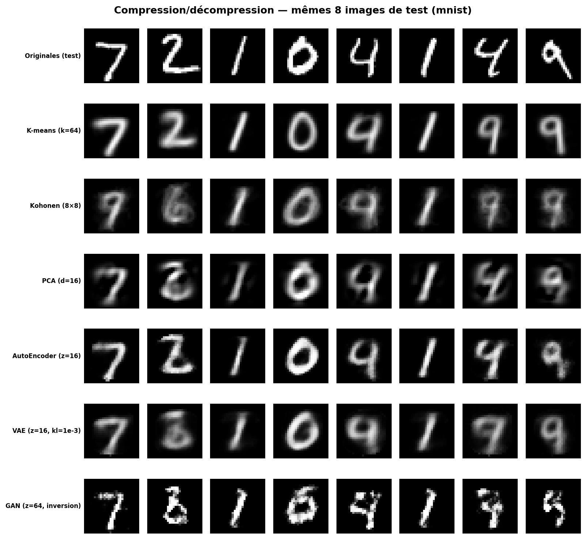
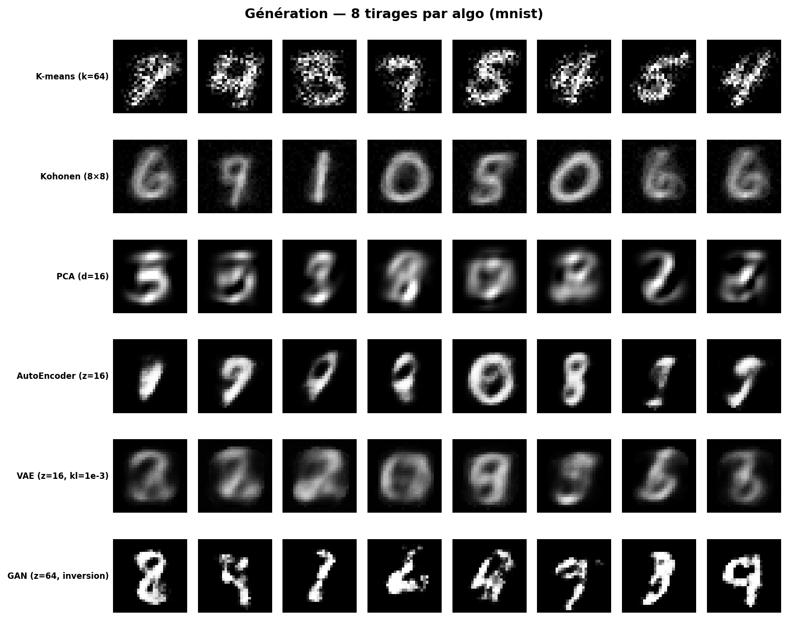
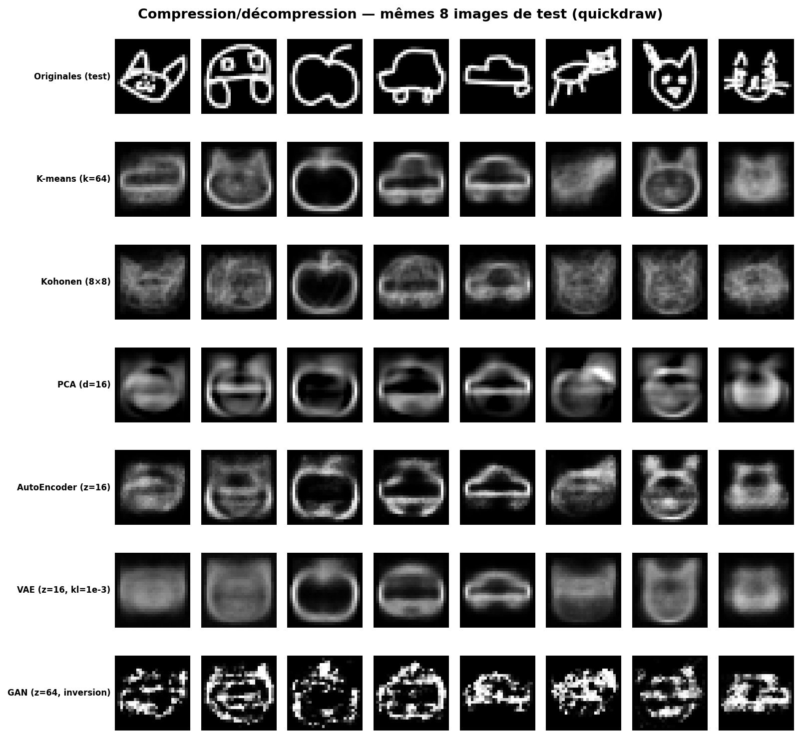
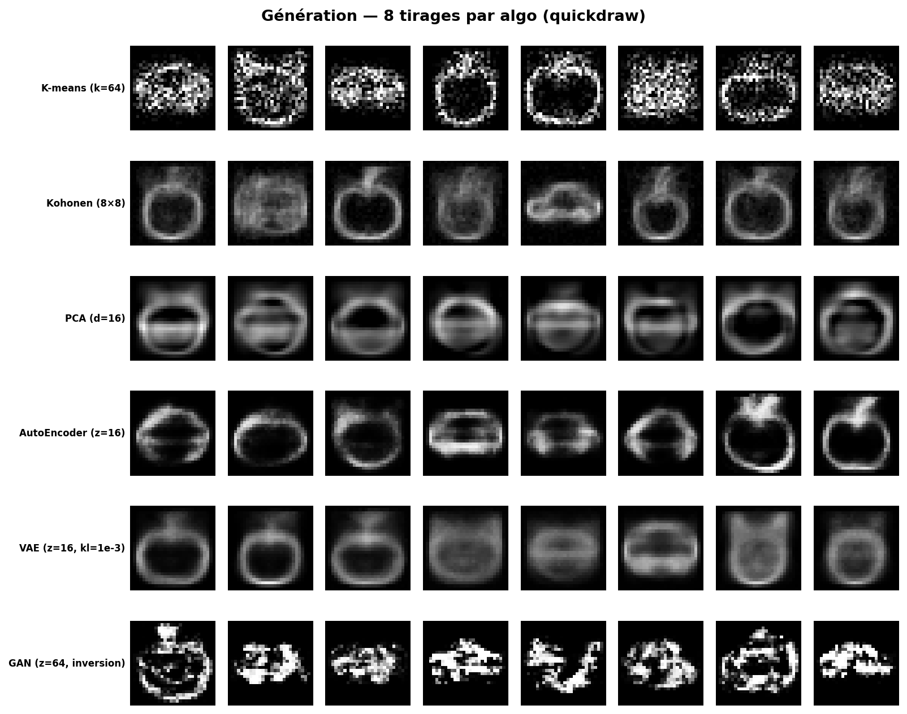
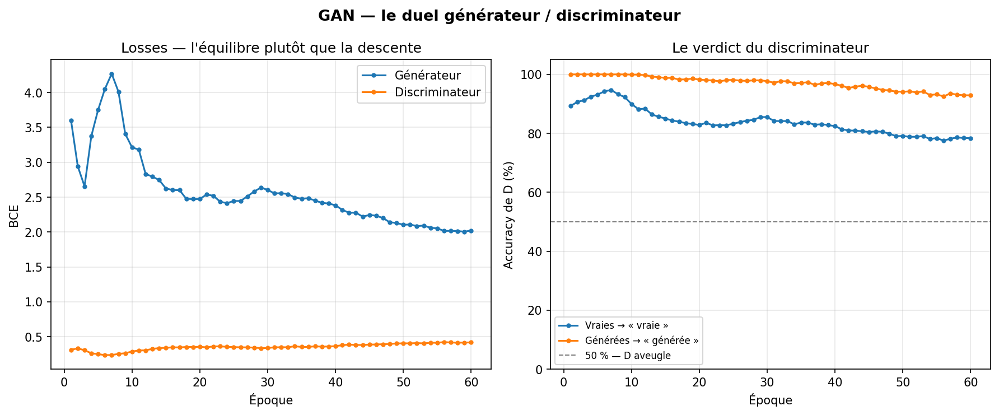
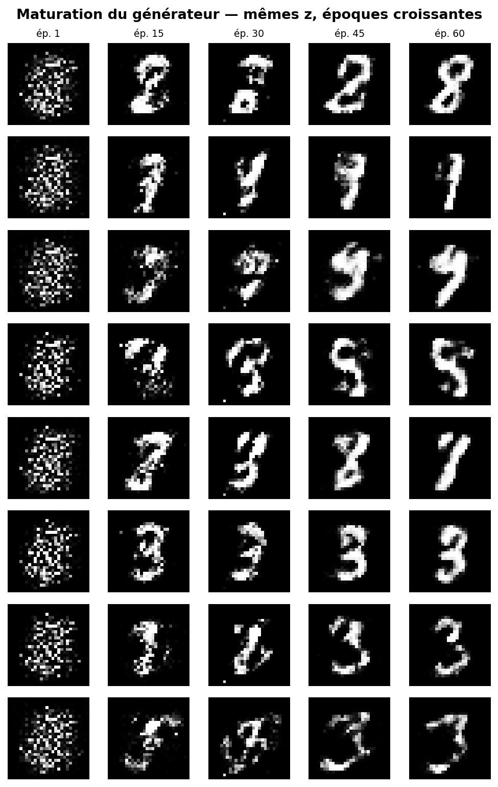
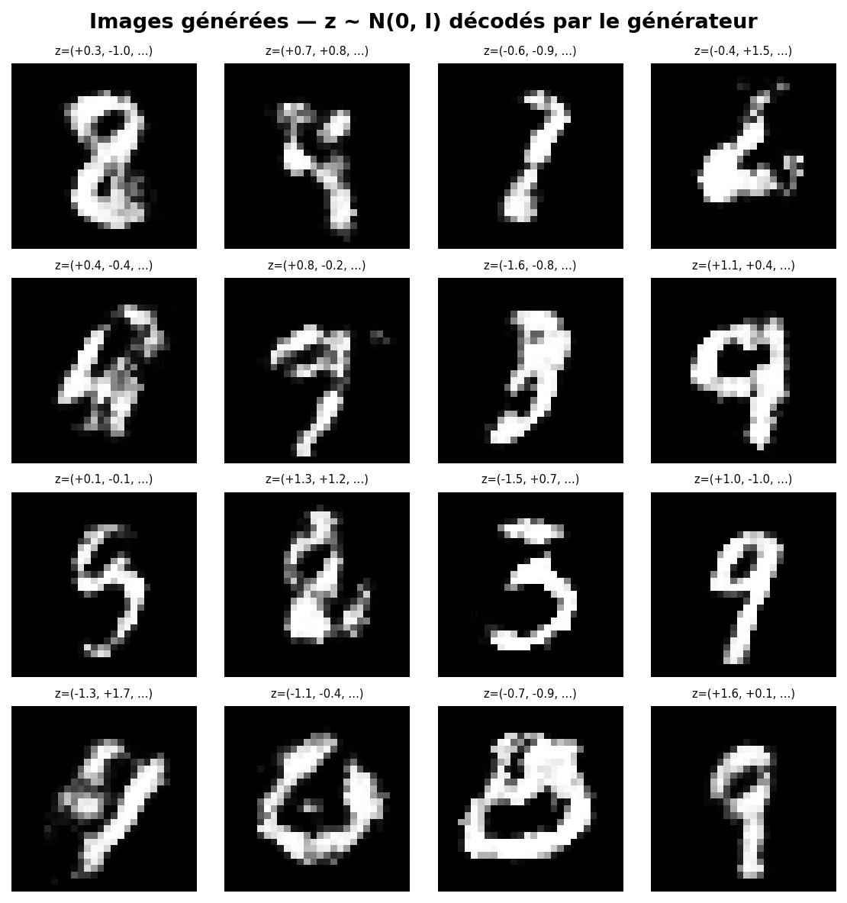
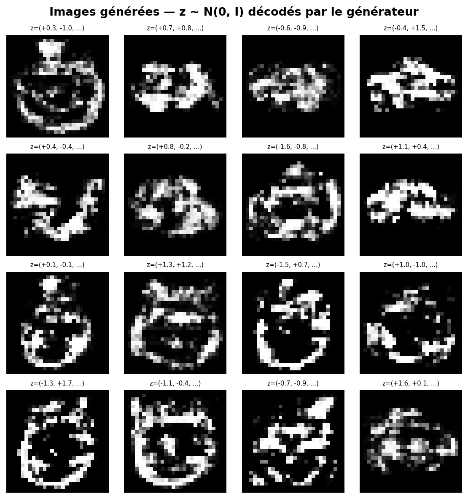
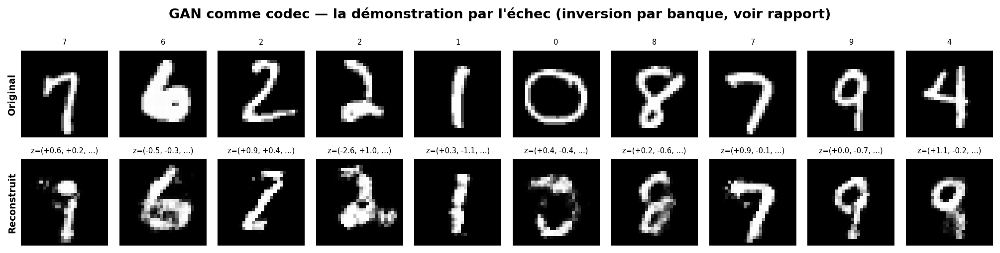

> **Document historique — état initial du projet.** Les tableaux, figures et conclusions ci-dessous sont conservés pour traçabilité. Ils ne sont pas des résultats recalculés avec le protocole corrigé du 5 novembre 2026. Consulter [le bilan de validation actuel](../VALIDATION_ET_METHODOLOGIE.md) et le README pour les nouvelles définitions des métriques, la séparation validation/test et les commandes exécutables. Le support PowerPoint de ce dossier est également historique.

# Rapport final — Unsupervised Deep Learning Toolbox

**Projet 2026 · 5A-IABD · M2-t3 Unsupervised Deep Learning** — encadrant : Nicolas Vidal.

Ce document est le rendu final consolidé du projet : il présente le dataset
choisi, le protocole de test, les six modèles implémentés et testés, leurs
résultats chiffrés, et la conclusion comparative — *quand utiliser quel
algorithme, pour quelle tâche*. Les rapports d'expériences détaillés par
algorithme (sweeps d'hyperparamètres, dizaines de tests) restent en annexe
dans `documentation/` ; celui-ci en est la synthèse et le verdict.

---

## 1. Objectif et périmètre

Le syllabus demande de constituer une **boîte à outils d'algorithmes
classiques de l'apprentissage non supervisé**, chacun implémenté
personnellement, et de discuter de l'utilité de chaque algorithme sur **trois
types de tâches** :

1. **Projection** des données dans un espace de faible dimension, pour
   visualisation ;
2. **Compression / décompression** ;
3. **Génération de données synthétiques**.

Six algorithmes sont livrés, chacun sous la même interface (`src/algo_base.py`)
et explorable dans la même application Gradio (`src/app.py`) :

| Algorithme | Rendu | Cœur de l'implémentation |
|---|---|---|
| k-Means (Lloyd) | étape intermédiaire | TensorFlow, écrit à la main (pas de `sklearn`) |
| PCA | étape intermédiaire | NumPy pur (`np.linalg.eigh` sur la covariance) |
| AutoEncoder simple | étape intermédiaire | Keras (architecture et entraînement conçus main) |
| SOM / Kohonen | rendu final | NumPy pur (grille, voisinage gaussien, tout à la main) |
| VAE | rendu final | Keras + boucle `GradientTape` maison (reparameterization trick, KL) |
| **GAN** | rendu final | **NumPy pur — passe avant, rétro-propagation et Adam écrits à la main** |

Chaque algorithme est appliqué aux **deux datasets** (MNIST et Quick, Draw!)
et discuté sur les trois tâches — y compris là où il échoue : l'échec du GAN
en compression ou du k-Means en génération n'est pas masqué, il est **mesuré**,
car c'est précisément ce que le projet cherche à établir.

---

## 2. Les datasets

### 2.1 MNIST — la référence

60 000 images d'entraînement / 10 000 de test, 10 classes de chiffres
manuscrits, 28×28 niveaux de gris. Chargé via Keras, normalisé dans [0, 1] et
aplati en vecteurs de 784 — le **format commun** de tout le projet
(`src/data_import.py`).

### 2.2 Quick, Draw! — le dataset choisi par le groupe

Le dataset [Quick, Draw!](https://github.com/googlecreativelab/quickdraw-dataset)
de Google : 50 millions de croquis dessinés à main levée par des joueurs du
jeu éponyme, publiés sous CC BY 4.0. Nous utilisons les **bitmaps 28×28
officiels** (`.npy`), c'est-à-dire exactement le format de MNIST — ce qui rend
toutes les comparaisons directes.

Deux variantes servent le projet :

- **`quickdraw`** — 3 classes (*cat, apple, car*), 10 000 dessins par classe ;
- **`quickdraw10`** — 10 classes (*+ fish, house, tree, clock, star, umbrella,
  airplane*), 6 000 par classe, soit 60 000 images : un Quick, Draw! aussi
  « large » que MNIST, utilisé dans les sweeps k-Means.

Pourquoi ce choix : même géométrie que MNIST (fond uniforme, un objet centré),
mais une **variabilité bien plus grande** — mille façons de dessiner un chat,
des traits fins, des styles libres. C'est le contraste parfait pour tester la
robustesse des algorithmes : ce qui marche sur MNIST survivra-t-il à des
données plus libres ? (Réponse courte : pas toujours, et c'est tout l'intérêt.)

Le découpage train/test est de 1/7 (le ratio de MNIST), mélangé et tiré avec
la graine 42 : **tous les scripts voient exactement les mêmes splits**.

---

## 3. Protocole de test

Le protocole vit dans un script unique et reproductible :
`src/experiments/compare_all.py`. Toute valeur de ce rapport en sort (ou du
banc de sweeps `run_experiments.py` pour les études par algorithme).

**Données.** Pour chaque dataset : entraînement sur les 10 000 premières
images du split train, évaluation sur les 2 000 premières du split test —
jamais vues à l'entraînement. Graine 42 partout (splits, initialisations,
tirages latents).

**Configurations.** Une configuration raisonnable par algorithme — le but est
la comparaison *entre* algorithmes à budget comparable, pas le record de
chacun :

- k-Means k=64 et SOM 8×8=64 : **à k égal**, pour isoler l'effet de la
  topologie ;
- PCA d=16, AutoEncoder z=16, VAE z=16 : **à budget de code égal**
  (16 flottants), pour isoler l'effet de la non-linéarité puis de la
  régularisation ;
- GAN z=64, entraîné par `src/gan/train_gan.py` (60 époques, ~20 000 images
  MNIST / ~25 700 Quick, Draw!).

Les deux familles (code discret à 6 bits contre code continu à 512 bits) ne
jouent **pas** à budget égal entre elles — c'est assumé et affiché : les
colonnes *bits/image* et *ratio* du tableau rendent l'écart explicite.

**Métriques communes** (`src/utils/metrics_common.py`, NumPy) :

- *Tâche 2 — compression* : **MSE** par pixel, **PSNR** (dB), **SSIM**
  (similarité structurelle, fenêtres 7×7), plus le débit (bits/image) et le
  taux de compression face aux 6 272 bits de l'image brute ;
- *Tâche 1 — projection* : **pureté** des clusters (codecs discrets) et
  **silhouette des vraies classes dans l'espace latent** (codecs continus) —
  les classes se séparent-elles dans la projection ? ;
- *Tâche 3 — génération* : 2 000 images générées par algorithme, comparées aux
  2 000 vraies images de test par une **FID simplifiée** — la distance de
  Fréchet entre gaussiennes ajustées sur des features PCA-50 (la vraie FID
  utilise un réseau Inception pré-entraîné ; sans réseau pré-entraîné dans ce
  projet, la PCA joue le rôle de featureur, ajustée sur les vraies images).
  Elle punit les deux échecs classiques : générer *à côté* des vraies images,
  et générer *toujours la même chose* (mode collapse), invisible à l'œil sur
  16 vignettes.

---

## 4. Les six algorithmes, tâche par tâche

Chaque sous-section suit le même plan : le principe en deux lignes, ce que
nous avons implémenté, puis le verdict sur les trois tâches. Les chiffres
cités renvoient aux tableaux de la section 5.

### 4.1 k-Means — le dictionnaire brut

**Principe.** k prototypes (centroïdes), chaque image est représentée par le
plus proche. L'algorithme de Lloyd alterne assignation et recentrage jusqu'à
convergence — l'inertie ne peut que décroître.

**Notre implémentation.** Lloyd écrit à la main en TensorFlow
(`src/kmeas/utils/kmeas.py`) : distances au carré vectorisées, garde-fous sur
les clusters vides, historique d'inertie persisté avec le modèle.

**T1 · Projection.** Le latent est un entier : rien à projeter. La lecture se
fait par les **distributions de classes par cluster** et la cartographie des
centroïdes. Les sweeps (annexe, 8 tests sur Quick, Draw! 3 classes, jusqu'à
k=5 000 sur 10 classes) montrent une pureté qui monte mécaniquement avec k —
à k=64 sur MNIST elle atteint déjà ~0,8.

**T2 · Compression.** Sa force relative : **6 bits par image** (k=64), un
ratio de ~1 045:1 — imbattable en débit. Le prix : la reconstruction est *le
centroïde*, donc floue et identique pour toutes les images d'un même cluster.
Les sweeps concluent qu'il faut k≥100 pour des images reconnaissables, k≥300
pour du presque net sur Quick, Draw!.

**T3 · Génération.** Un k-Means ne sait pas générer : `decode()` ne rendra
jamais que ses k centroïdes. Nous avons complété (rendu final) par le mieux
possible : un **mélange de gaussiennes diagonales** ajusté sur les clusters
(`src/kmeas/utils/generation.py`) — tirage d'un cluster au prorata de sa
taille, puis centroïde + bruit σ par pixel. Le résultat, mesuré et visible
dans le panneau de génération : des centroïdes neigeux. Le bruit indépendant
pixel à pixel ne respecte pas les traits — la démonstration que la génération
exige un modèle de la *structure* des images.

### 4.2 SOM / Kohonen — le dictionnaire ordonné

**Principe.** Un k-Means contraint par une grille : chaque neurone apprend
avec ses voisins (voisinage gaussien de largeur γ), donc les prototypes
voisins se ressemblent — la carte s'auto-organise.

**Notre implémentation.** NumPy pur (`src/kohonen/utils/kohonen.py`) : grille
rectangulaire affichée en hexagones, α constant, historique d'inertie, carte
des neurones morts, U-matrix.

**T1 · Projection.** Sa vraie valeur ajoutée : la **carte** est une projection
2D *ordonnée* du dataset — les classes occupent des régions contiguës, les
frontières se lisent sur l'U-matrix. C'est la meilleure « carte de terrain »
du projet, bien plus lisible qu'un nuage de points pour un non-spécialiste.

**T2 · Compression.** Même codec que k-Means (1 entier), même flou, avec une
MSE légèrement supérieure à k égal : le **prix de l'organisation topologique**
— chaque neurone fait un compromis entre coller à ses données et rester
proche de ses voisins. Les sweeps (annexe) : grille 20×20 et γ≈0,5 pour de
bons résultats sur Quick, Draw!.

**T3 · Génération.** Complétée au rendu final par l'**interpolation entre
neurones voisins** (`src/kohonen/utils/generation.py`) : on tire un neurone au
prorata de son activation, un voisin de grille, et un point entre les deux.
La topologie rend le « entre-deux » plausible — là où interpoler deux
centroïdes k-Means quelconques traverserait le vide. Meilleur que k-Means en
netteté (peu de bruit ajouté), mais toujours borné aux mélanges de prototypes
existants.

### 4.3 PCA — la référence linéaire

**Principe.** Les k directions orthogonales de variance maximale ; le code
d'une image est ses k coordonnées dans cette base.

**Notre implémentation.** NumPy pur (`src/utils/pca/`) : centrage,
covariance, `eigh`, tri spectral — sans `sklearn`. Le rapport PCA détaillé
(annexe) couvre les trois tâches avec le « codec d'Alice et Bob », le
compromis MSE/k, et la génération par gaussienne latente par classe.

**T1 · Projection.** PC1×PC2(×PC3) donne des nuages où MNIST se structure
déjà bien ; le spectre dit combien d'axes comptent. Le contraste clé mesuré en
annexe : MNIST concentre 87 % de variance sur 68 composantes, Quick, Draw! en
demande 183 pour 90 % — les croquis à main levée sont bien moins corrélés.

**T2 · Compression.** À d=16 (512 bits), la meilleure MSE des codecs *à
l'exception* de l'autoencodeur : la base optimale au sens L2 est dure à battre
pour une méthode qui s'ajuste en une décomposition, sans entraînement itératif
(quelques dixièmes de seconde).

**T3 · Génération.** Gaussienne ajustée sur le latent puis décodage. Sur
MNIST : des chiffres crédibles quoique lisses. Sur Quick, Draw! : bruité et
peu reconnaissable — la linéarité ne capture pas la structure des traits.
C'est la limite qui motive les trois modèles suivants.

### 4.4 AutoEncoder simple — la PCA non linéaire

**Principe.** Encodeur → goulot z → décodeur, entraînés à reconstruire
l'entrée (MSE). Une « PCA non linéaire » : mêmes usages, plus de pouvoir
d'expression.

**Notre implémentation.** Architectures denses et convolutionnelles conçues
main en Keras (`src/autoencoder/utils/model.py`), activations et goulot
paramétrables ; les poids voyagent comme *un seul vecteur* NumPy,
l'architecture dans les métadonnées — ce qui permet à l'app de traiter un
réseau exactement comme un tableau de centroïdes. Le rapport d'expériences
(annexe) balaie activation latente, dimension du goulot et profondeur.

**T1 · Projection.** À z=2, l'espace latent se dessine en entier (manifold) ;
à z=16, la silhouette des classes dans le latent bat nettement la PCA : la
non-linéarité déplie ce que la projection linéaire écrase.

**T2 · Compression.** **Le meilleur codec du projet** à budget égal (512
bits) : MSE et SSIM devant la PCA sur les deux datasets. C'est sa tâche
d'élection — il est littéralement entraîné pour.

**T3 · Génération.** Son point faible structurel : le latent n'est pas
régularisé, il a des trous. Échantillonner exige d'ajuster une gaussienne
*empirique* sur les codes (moyenne + covariance) et d'espérer que le décodeur
généralise entre eux. Ça marche à moitié — mieux que PCA, moins bien qu'un
VAE — et c'est fragile par construction.

### 4.5 VAE — l'autoencodeur qui sait générer

**Principe.** L'encodeur prédit une distribution (μ, σ) par image ; la loss
ajoute KL(N(μ,σ) ‖ N(0,1)), pondérée par `kl_weight`, qui tire tout le latent
vers la gaussienne standard. On perd un peu de fidélité, on gagne un espace
latent **lisse et échantillonnable**.

**Notre implémentation.** Boucle d'entraînement `GradientTape` écrite main
(`src/vae/utils/model.py`) : reparameterization trick z = μ + σ·ε, KL sommée
par dimension, trois courbes de loss persistées (totale / reconstruction /
KL). À `kl_weight=0` on retombe exactement sur l'autoencodeur simple — le
banc de sweeps le vérifie.

**T1 · Projection.** Latent centré-réduit par construction : les nuages sont
comparables d'un modèle à l'autre, sans trous béants. Confortable et lisible.

**T2 · Compression.** Légèrement en retrait de l'AE simple à budget égal —
c'est la KL qui « paie » : l'arbitrage reconstruction/régularisation est
visible sur les courbes de loss décomposées.

**T3 · Génération.** Sa récompense : **z ~ N(0, I), directement** — sans
gaussienne empirique, sans banque, sans rien. Génération stable, diverse,
couvrant les classes ; le flou de moyenne (hérité de la loss MSE) reste sa
signature visuelle face au GAN.

### 4.6 GAN — le générateur pur (nouveau, rendu final)

**Principe.** Deux réseaux s'affrontent (Goodfellow, 2014) : le générateur
apprend z → image, le discriminateur apprend à distinguer vraies et générées ;
l'équilibre du jeu force G à produire des images indistinguables des vraies.

**Notre implémentation.** **NumPy pur, de bout en bout**
(`src/gan/utils/model.py`) : passe avant, rétro-propagation couche par couche
(y compris le gradient qui traverse D pour instruire G), Adam écrit main
(β₁=0,5, la recommandation DCGAN), BCE calculée sur les logits pour la
stabilité numérique, lissage d'étiquettes (0,9). Le duel se lit sur quatre
courbes persistées (loss G, loss D, accuracy de D sur vraies et sur générées)
et la maturation du générateur sur des instantanés à époques croissantes —
les mêmes 16 z décodés du bruit initial à l'image finale.

**T1 · Projection.** Le GAN n'ayant pas d'encodeur, les images sont projetées
par **inversion approximative** : le z de la génération la plus proche parmi
une banque de 2 048 candidates, régénérée déterministe depuis la graine du
modèle (`src/gan/utils/codec.py`). Le nuage se regarde avec cette réserve : il
projette l'image sur *ce que G sait dessiner*, pas sur ce qu'elle contient.

**T2 · Compression.** **L'échec instructif, volontairement mesuré.** Le débit
sur le papier est bon (64 flottants), mais la « reconstruction » est la
génération la plus ressemblante — pas l'image. La MSE, la pire du tableau, est
la démonstration chiffrée qu'**un GAN est un générateur, pas un codec** : rien
dans son entraînement ne l'a jamais contraint à savoir *retrouver* une image.

**T3 · Génération.** Sa raison d'être : z ~ N(0, I) → G(z). Face au VAE, la
différence de nature se voit : la loss adversariale pousse vers des exemplaires
*nets* (un faux doit tromper D), là où la MSE du VAE pousse vers la *moyenne
des possibles* (donc le flou). Sur nos MLP entraînés CPU, le GAN produit des
images plus contrastées, au prix d'une couverture moins régulière des classes
— l'arbitrage netteté/couverture que la FID et les panneaux de la section 5
mettent en évidence.

---

## 5. Résultats

Tous les chiffres sortent de `python src/experiments/compare_all.py`
(graine 42 ; GAN entraînés par `src/gan/train_gan.py`). Rappel de lecture :
MSE ↓ = mieux, PSNR/SSIM/pureté/silhouette ↑ = mieux, FID simplifiée ↓ = mieux.
La pureté n'a de sens que pour les codecs discrets ; la silhouette mesure la
séparation des clusters (discret, dans l'espace pixel) ou des vraies classes
(continu, dans le latent).

### 5.1 MNIST

| Algo | Train (s) | Bits/img | Ratio | MSE ↓ | PSNR ↑ | SSIM ↑ | Pureté ↑ | Silhouette ↑ | FID simplifiée ↓ |
|---|---|---|---|---|---|---|---|---|---|
| K-means (k=64) | 12 | 6 | 1045:1 | 0.03891 | 14.1 | 0.641 | 0.786 | 0.0428 | 7.262 |
| Kohonen (8×8) | 16.3 | 6 | 1045:1 | 0.04652 | 13.32 | 0.508 | 0.643 | 0.00641 | 22 |
| PCA (d=16) | 0.284 | 512 | 12:1 | 0.02613 | 15.83 | 0.624 | — | 0.0876 | 11.35 |
| AutoEncoder (z=16) | 11.3 | 512 | 12:1 | 0.02427 | 16.15 | 0.765 | — | 0.0702 | 7.35 |
| VAE (z=16, kl=1e-3) | 14 | 512 | 12:1 | 0.03615 | 14.42 | 0.575 | — | 0.101 | 16.53 |
| GAN (z=64, inversion) | — | 2048 | 3:1 | 0.04743 | 13.24 | 0.694 | — | 0.00995 | 4.48 |

### 5.2 Quick, Draw! (cat / apple / car)

| Algo | Train (s) | Bits/img | Ratio | MSE ↓ | PSNR ↑ | SSIM ↑ | Pureté ↑ | Silhouette ↑ | FID simplifiée ↓ |
|---|---|---|---|---|---|---|---|---|---|
| K-means (k=64) | 7.79 | 6 | 1045:1 | 0.06369 | 11.96 | 0.453 | 0.93 | 5.66e-05 | 8.411 |
| Kohonen (8×8) | 10.5 | 6 | 1045:1 | 0.07087 | 11.5 | 0.338 | 0.892 | -0.0149 | 24.44 |
| PCA (d=16) | 0.286 | 512 | 12:1 | 0.05161 | 12.87 | 0.478 | — | 0.128 | 13.32 |
| AutoEncoder (z=16) | 12 | 512 | 12:1 | 0.05043 | 12.97 | 0.567 | — | 0.124 | 10.29 |
| VAE (z=16, kl=1e-3) | 13.3 | 512 | 12:1 | 0.06412 | 11.93 | 0.4 | — | 0.136 | 21.49 |
| GAN (z=64, inversion) | — | 2048 | 3:1 | 0.1007 | 9.969 | 0.428 | — | 0.0129 | 7.554 |

### 5.3 Lecture des chiffres

Cinq enseignements, constants sur les deux datasets :

1. **L'autoencodeur est le meilleur codec du projet** à budget égal : meilleure
   MSE ET meilleur SSIM sur MNIST (0,0243 / 0,765) comme sur Quick, Draw!
   (0,0504 / 0,567), devant la PCA — l'écart est l'apport net de la
   non-linéarité. La PCA reste remarquable rapportée à son coût : ~0,3 s
   d'« entraînement » contre 11-14 s pour les réseaux.

2. **Le VAE paie sa KL exactement où la théorie le prédit** : en retrait de
   l'autoencodeur en reconstruction (0,0362 contre 0,0243 sur MNIST), mais
   **meilleure silhouette des classes dans le latent** des deux datasets
   (0,101 et 0,136) — l'espace régularisé est le plus lisible, et c'est lui
   qui rend la génération directe possible.

3. **Le GAN gagne la génération et perd la compression — mesurablement.** La
   meilleure FID simplifiée des deux tableaux (4,5 sur MNIST, 7,6 sur
   Quick, Draw!) ET la pire reconstruction (MSE 0,047 / 0,101 par inversion) :
   les deux verdicts en un seul modèle, c'est la démonstration centrale du
   projet — générer et compresser sont deux métiers.

4. **La FID simplifiée a un angle mort instructif : le k-Means.** Son mélange
   de gaussiennes obtient une FID flatteuse (7,3 / 8,4) parce que la métrique
   ne regarde que les statistiques d'ordre 2 de features *linéaires* — que le
   bruit par pixel imite bien. Le panneau visuel ci-dessous corrige le
   verdict : les images k-Means sont des centroïdes neigeux, pas des chiffres.
   Kohonen subit l'effet inverse (FID 22 / 24) : ses interpolations sont
   *plus propres* mais moins diverses — la métrique punit la couverture, pas
   la netteté. Moralité assumée du protocole : chiffres ET panneaux, jamais
   l'un sans l'autre.

5. **Quick, Draw! dégrade tout le monde, mais pas uniformément.** Toutes les
   MSE se dégradent d'environ moitié par rapport à MNIST, mais la pureté des
   codecs discrets *monte* (0,93 pour k-Means — 3 classes seulement) tandis
   que la génération se dégrade partout : les croquis à main levée, moins
   corrélés pixel à pixel, sont plus durs à modéliser qu'à trier. C'est le
   contraste déjà mesuré par le spectre PCA (68 composantes pour 87 % de
   variance sur MNIST, 183 pour 90 % sur Quick, Draw!).

Les panneaux visuels correspondants (mêmes images de test pour tous les
algos, mêmes graines de génération) :

Et les vues signature du GAN (les autres algos ont les leurs en annexe et
dans l'app) :

---

## 6. Quand utiliser quoi — le tableau final

La synthèse de tout le projet, algorithme × tâche. ★★★ = l'outil qu'on
recommande pour la tâche ; ★ = possible mais dégradé ; ✗ = contre-indiqué.

| | T1 · Projection / visualisation | T2 · Compression | T3 · Génération |
|---|---|---|---|
| **k-Means** | ★ — pas de projection continue ; lecture par distributions de clusters. Utile comme *quantification* préalable. | ★★ — imbattable en débit (1 entier), mais reconstruction = centroïde flou, identique par cluster. Le choix si le débit prime sur tout. | ✗ — au mieux un mélange de gaussiennes neigeux (mesuré ici). |
| **SOM / Kohonen** | ★★★ — LA carte : projection 2D *ordonnée*, U-matrix, régions de classes contiguës. Le meilleur outil d'exploration visuelle du projet. | ★★ — comme k-Means, MSE un peu pire à k égal (le prix de la topologie). | ★ — l'interpolation entre voisins est plausible (la topologie paie), mais reste bornée aux mélanges de prototypes. |
| **PCA** | ★★ — nuages PC1×PC2 honnêtes, spectre = diagnostic de complexité du dataset. Toujours la *première chose à lancer*. | ★★ — excellente à coût d'entraînement quasi nul ; battue par l'AE à budget égal dès que les données sont non linéaires. | ★ — crédible sur données simples (MNIST), bruité au-delà. |
| **AutoEncoder** | ★★ — latent non linéaire qui sépare mieux que la PCA ; manifold lisible à z=2. | ★★★ — le meilleur codec du projet à budget égal : c'est sa tâche d'élection. | ★ — possible via gaussienne empirique, fragile par construction (latent troué). |
| **VAE** | ★★★ — latent régularisé N(0,1) : nuages comparables, sans trous. | ★★ — un cran sous l'AE simple : la KL se paie en fidélité. | ★★★ — génération directe z~N(0,I), stable et diverse ; flou de moyenne en signature. |
| **GAN** | ★ — uniquement par inversion approximative (pas d'encodeur). | ✗ — l'échec mesuré du projet : rien ne l'entraîne à retrouver une image. | ★★★ — sa raison d'être : les images les plus *nettes* du projet ; à surveiller pour le mode collapse (d'où la FID). |

Trois règles à retenir :

1. **Explorer** un dataset inconnu : PCA d'abord (une seconde, et le spectre
   dit la complexité), SOM ensuite (la carte se montre à n'importe qui).
2. **Compresser** : autoencodeur si on peut entraîner, PCA sinon ; k-Means/SOM
   uniquement si le débit (quelques bits) est la contrainte dure.
3. **Générer** : VAE pour la couverture et la stabilité, GAN pour la netteté ;
   tout ce qui est à base de prototypes (k-Means, SOM) ne « génère » que des
   variations de ce qu'il a déjà figé.

---

## 7. Limites et choix assumés

Signalés explicitement plutôt que tranchés en silence :

- **k-Means en TensorFlow, AE/VAE en Keras.** Le syllabus demande des
  implémentations personnelles ; Lloyd est bien écrit à la main (pas de
  `sklearn.cluster`), et les AE/VAE assemblent des couches Keras dans des
  architectures et des boucles d'entraînement conçues par nous (GradientTape,
  KL, reparameterization). Le **GAN, lui, est en NumPy intégral** — passe
  avant, backward, Adam — précisément pour démontrer la maîtrise de ce que
  les frameworks cachent. Réécrire k-Means/AE/VAE en NumPy après validation
  de l'étape intermédiaire aurait invalidé les modèles sauvegardés et les
  dizaines de tests des annexes pour un gain pédagogique déjà couvert par le
  GAN.
- **La FID est « simplifiée »** (features PCA-50, pas Inception) : valable
  pour comparer nos modèles entre eux sur les mêmes vraies images, pas
  comparable aux FID de la littérature.
- **L'inversion du GAN par banque** (2 048 candidates) est grossière — c'est
  un choix : elle borne honnêtement ce qu'un GAN sans encodeur sait faire en
  compression. Une inversion par descente de gradient sur z donnerait mieux,
  sans changer le verdict.
- **GAN = MLP entraîné CPU.** Pas de convolutions ni de GPU : les générations
  sont nettes mais pas parfaites, et le duel demande ses ~60 époques. Un
  DCGAN convolutionnel est l'extension naturelle.
- **Le code dupliqué entre `autoencoder/utils/model.py` et
  `vae/utils/model.py`** est assumé : chaque algo reste autonome chez lui
  (le principe d'architecture du projet) ; le VAE documente explicitement ce
  qu'il change de l'AE. Les vues, elles, sont réellement partagées (VAE et
  GAN réimportent celles de l'autoencodeur).
- **Sweeps Quick, Draw! 10 classes** : couverts pour k-Means (annexe), pas
  refaits pour les autres algos — la variante 3 classes suffit aux
  comparaisons du rendu, la 10 classes reste disponible dans l'app.

---

## 8. Conclusion

Le projet livre ce que le syllabus demandait : une base d'algorithmes
classiques du non-supervisé, implémentés personnellement, et surtout une
**compréhension de quand utiliser lesquels** — résumée dans le tableau de la
section 6 et chiffrée dans la section 5.

Le fil rouge des résultats : les trois tâches du syllabus sont **trois
métiers différents**, et aucun algorithme n'est bon partout. Les modèles à
prototypes (k-Means, SOM) gagnent le débit et la lisibilité, et perdent la
génération. Les modèles à code continu (PCA, AE) gagnent la fidélité de
reconstruction, mais seule une *contrainte de structure* sur le latent (la KL
du VAE) ou un *adversaire* (le D du GAN) achète une vraie génération — le VAE
en couverture, le GAN en netteté. Et le contraste MNIST / Quick, Draw!
traverse tout le tableau : plus les données sont libres, plus les méthodes
linéaires et les dictionnaires décrochent, plus les modèles profonds creusent
l'écart.

Prolongements naturels : un DCGAN convolutionnel, un VAE convolutionnel plus
profond, une inversion de GAN par optimisation, et un modèle de diffusion —
la famille qui, depuis, a réconcilié la netteté du GAN avec la stabilité du
VAE.

---

## Annexes

- **A. Rapport k-Means & Kohonen** (sweeps MNIST / Quick, Draw! 3 et 10
  classes) : `documentation/Rapport Unsupervised Deep Learning …md`
- **B. Rapport PCA** (le codec d'Alice et Bob, spectres, génération) :
  `documentation/pca/rapport_pca_mnist_quickdraw_ODF.md`
- **C. Rapport AutoEncoder / VAE** (sweeps d'activations et de goulot) :
  `documentation/autoencoder/auto_encodeur_experiment.md`
- **D. Reproduction** : README racine, section « Reproduire les résultats du
  rapport » — trois commandes, graines fixes.
- **E. Démonstration** : `python src/app.py` — les six algos, tous les
  onglets, les modèles du rendu pré-chargés.
